<!-- BEGIN: banner -->
<p align="center">
  
</p>
<!-- END: banner -->

<div align="center">

[](https://anishh15.github.io/SLMJury/#/cite)
[](https://arxiv.org/abs/2606.07810)
[](https://anishh15.github.io/SLMJury/)
[](https://pypi.org/project/slmjury/)
[](LICENSE)

[**Findings**](#findings) &nbsp;·&nbsp; [**Leaderboard**](#leaderboard) &nbsp;·&nbsp; [**Quick start**](#quick-start) &nbsp;·&nbsp; [**Reproduce**](#reproduce-the-paper) &nbsp;·&nbsp; [**Citation**](#citation)

</div>

<!-- BEGIN: results -->
<p align="center">
  
</p>
<!-- END: results -->

<p align="center"><sub>Serving cost is an estimate (<a href="experiments/scaling_cost/analyze.py">method</a>).</sub></p>

## News

| Date | Update |
|:--|:--|
| **Nov 2026** | SLMJury is accepted at the **EACL 2027** main conference. |
| **Nov 2026** | Version 0.2.0: the code for every experiment in the paper, including the large judges. |
| **Jun 2026** | The paper is on [arXiv](https://arxiv.org/abs/2606.07810). |
| **May 2026** | First release on [PyPI](https://pypi.org/project/slmjury/) and the [project website](https://anishh15.github.io/SLMJury/). |

## What is SLMJury?

<!-- BEGIN: about -->
A judge reads a question, the reference answer and a student's reasoning, and answers `Correct`, `Incorrect` or `Undefined`. Accuracy is how often it agrees with a programmatic oracle, over 64,824 judgments per configuration.
<!-- END: about -->

<!-- BEGIN: verdict -->
<p align="center">
  
</p>
<!-- END: verdict -->

<!-- BEGIN: overview -->
<p align="center">
  
</p>
<!-- END: overview -->

## Findings

Accuracy is the share of a judge's verdicts that match the oracle, which checks each student answer against the reference. Comparisons between judges are paired on the same items.

<!-- BEGIN: finding_scale -->
<a href="https://anishh15.github.io/SLMJury/#/findings/scale">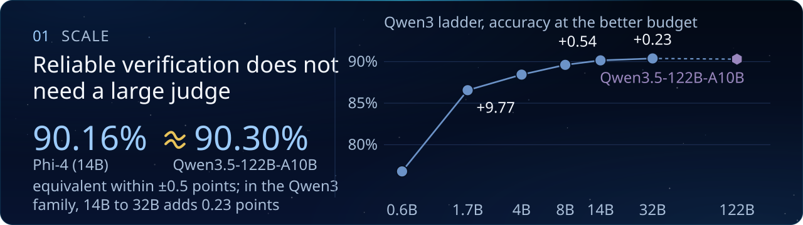</a>

[Interactive version →](https://anishh15.github.io/SLMJury/#/findings/scale)

<details>
<summary>More numbers and figures</summary>
<br>

Phi-4 is also significantly more accurate than the other five large judges. A thousand quick verdicts cost an estimated $0.34 from Phi-4, $3.23 from Qwen2.5-72B, $6.28 from Llama-3.3-70B and $10.83 from Qwen3.5-122B-A10B, and all three large judges are within 0.35 points of Phi-4's accuracy.

<p align="center">
  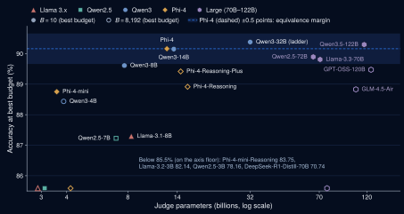
</p>

<p align="center">
  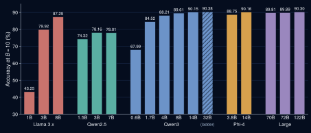
</p>
<p align="center"><sub>The axis starts at 30%.</sub></p>

</details>
<!-- END: finding_scale -->

<!-- BEGIN: finding_budget -->
<a href="https://anishh15.github.io/SLMJury/#/findings/budget">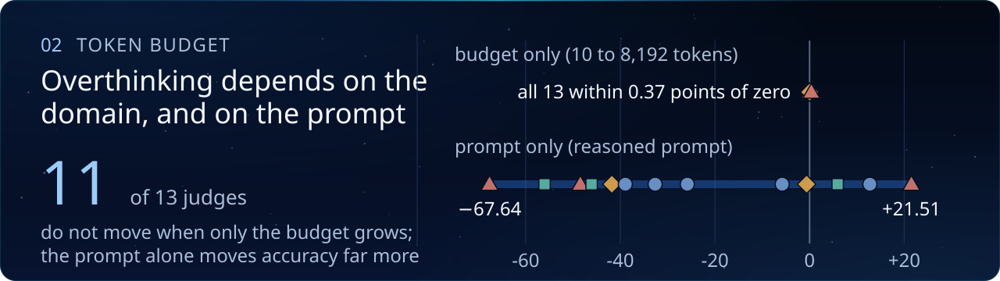</a>

[Interactive version →](https://anishh15.github.io/SLMJury/#/findings/budget)

<details>
<summary>More numbers and figures</summary>
<br>

Quick verdicts win on math for 8 of 13 judges that run at both budgets, and reasoning wins on general tasks for 8 of 13, so the two effects partially cancel in any single-number summary. Reasoning lifts Qwen3-4B by 23.09 points on WinoGrande (71.47% → 94.55%), where commonsense inference is hard to settle in ten tokens.

At 10 tokens the reasoned prompt is cut off mid-explanation, and accuracy falls with the share of verdicts that can be parsed (r = 0.93).

<p align="center">
  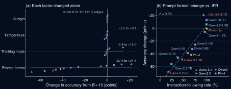
</p>

<p align="center">
  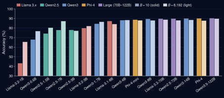
</p>
<p align="center"><sub>The axis starts at 30%.</sub></p>

<p align="center">
  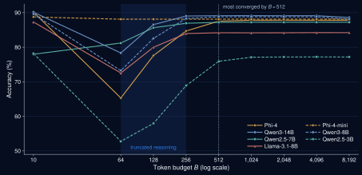
</p>

<p align="center">
  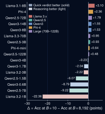
</p>

<p align="center">
  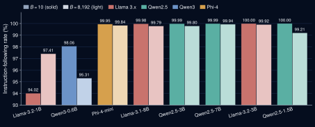
</p>
<p align="center"><sub>The axis starts at 93%.</sub></p>

</details>
<!-- END: finding_budget -->

<!-- BEGIN: finding_domain -->
<a href="https://anishh15.github.io/SLMJury/#/findings/domain">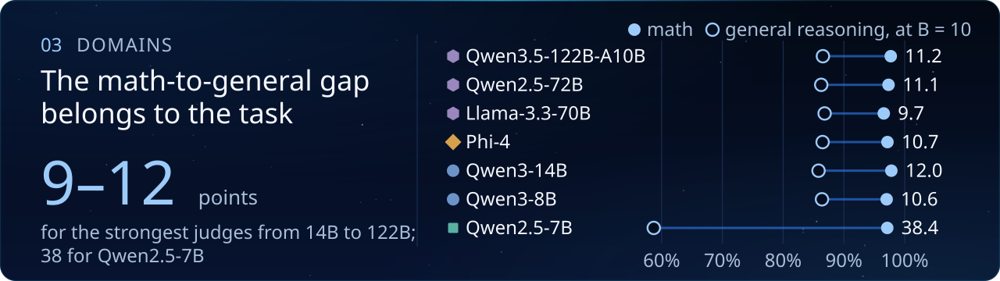</a>

[Interactive version →](https://anishh15.github.io/SLMJury/#/findings/domain)

<details>
<summary>More numbers and figures</summary>
<br>

Qwen2.5-7B scores 97.1% on math and 58.7% on general reasoning. The large judges other than DeepSeek-R1-Distill show the same gap (8.5–11.2 points) as the strongest small ones (8.5–12.0), and no judge at any scale clears 80% on HellaSwag. Each domain is the unweighted mean of its three datasets.

<p align="center">
  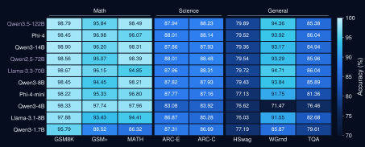
</p>

</details>
<!-- END: finding_domain -->

<!-- BEGIN: finding_open -->
<a href="https://anishh15.github.io/SLMJury/#/findings/open-ended">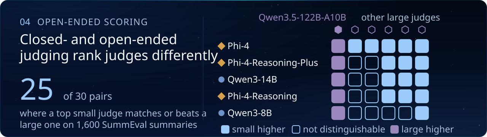</a>

[Interactive version →](https://anishh15.github.io/SLMJury/#/findings/open-ended)

<details>
<summary>More numbers and figures</summary>
<br>

The five strongest small judges score higher than a large judge in 15 of the 30 comparisons and are not distinguishable in 10; all five losses are to Qwen3.5-122B-A10B. Phi-4 reaches ρ = 0.520, significantly above five of the six large judges and 0.022 below Qwen3.5-122B-A10B.

On MT-Bench, Phi-4 ranks sixth among the small judges (ρ = 0.269), and Phi-4-Reasoning ranks second (ρ = 0.505).

<p align="center">
  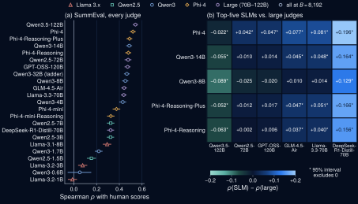
</p>

<p align="center">
  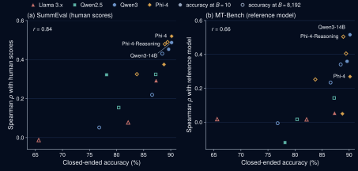
</p>

</details>
<!-- END: finding_open -->

<!-- BEGIN: finding_strategies -->
<a href="https://anishh15.github.io/SLMJury/#/findings/strategies">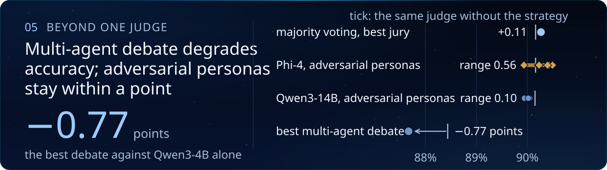</a>

[Interactive version →](https://anishh15.github.io/SLMJury/#/findings/strategies)

<details>
<summary>More numbers and figures</summary>
<br>

In multi-agent debate (the Reflect-Critique-Refine protocol), the best configuration reaches 87.67%, against 88.44% for Qwen3-4B alone. A binary verdict carries little to exchange, so the critique step can pass a confident wrong verdict to an agent that was right.

With majority voting, the best of the ten three-judge juries reaches 90.27%. Voting gains little because the top judges share most of their mistakes. Judge rankings hold across five wordings of the judging instruction (mean pairwise Kendall's τ = 0.75 at B = 10).

<p align="center">
  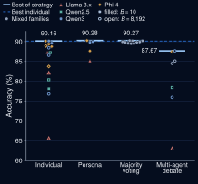
</p>

<p align="center">
  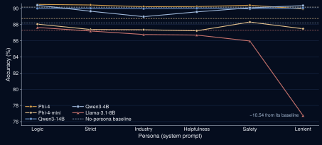
</p>

<p align="center">
  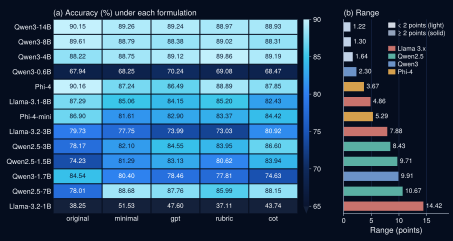
</p>

<p align="center">
  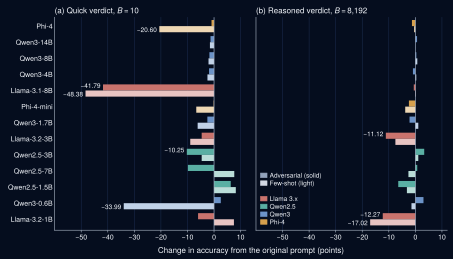
</p>

</details>
<!-- END: finding_strategies -->

<!-- BEGIN: finding_students -->
<a href="https://anishh15.github.io/SLMJury/#/findings/students">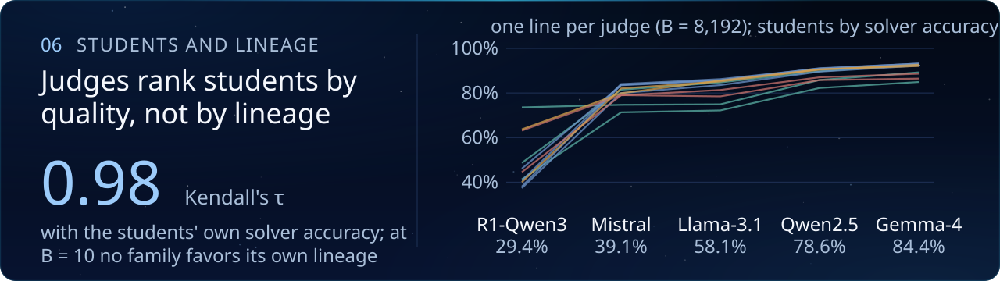</a>

[Interactive version →](https://anishh15.github.io/SLMJury/#/findings/students)

<details>
<summary>More numbers</summary>
<br>

Given room to reason, capable judges also agree with each other on the order (τ = 0.96). To separate lineage from quality, a strong Qwen3-family student joins the pool and each judge's general leniency is differenced out. At B = 10 the lineage effect on the false-accept rate is +0.010 for Qwen3, −0.075 for Llama and +0.010 for Qwen2.5. A preference appears only once judges reason (B = 8,192), mainly for Qwen3 (+0.21; Llama +0.09, Qwen2.5 +0.04).

</details>
<!-- END: finding_students -->

> [!TIP]
> **Choosing a judge.** With a reference answer, use a small judge and a quick verdict. For open-ended scoring, pick a small judge validated on human labels.

## Leaderboard

<!-- BEGIN: leaderboard_figure -->
<p align="center">
  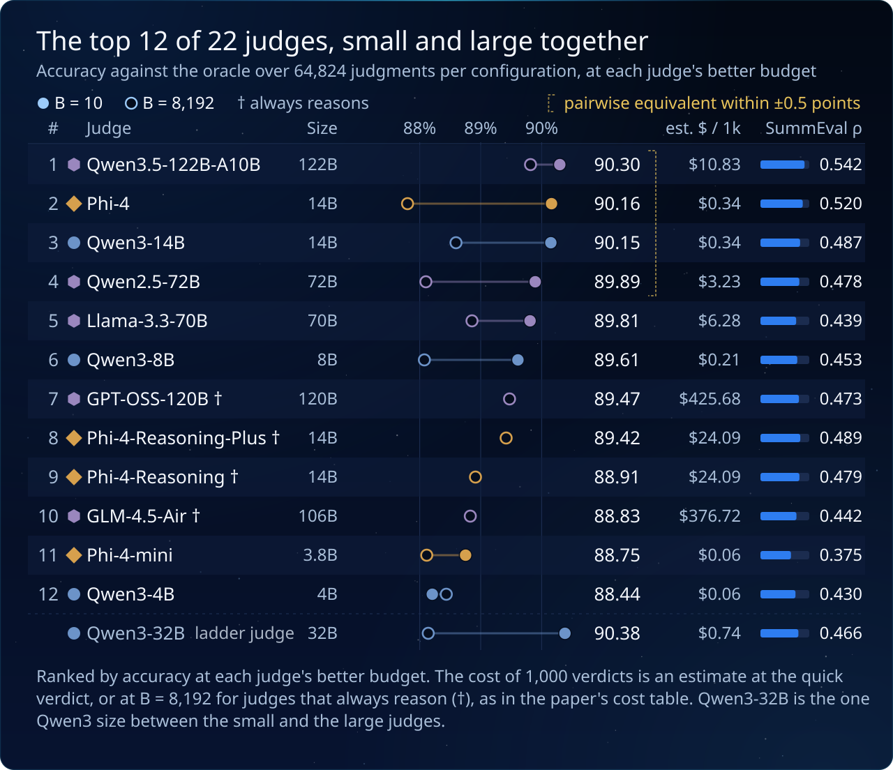
</p>
<!-- END: leaderboard_figure -->

<details>
<summary><b>The full leaderboard</b>: every judge, with MT-Bench ρ</summary>
<br>

<!-- BEGIN: leaderboard -->
| # | Judge | Size | Type | Acc. B = 10 | Acc. B = 8,192 | SummEval ρ | MT-Bench ρ |
|:-:|:--|--:|:-:|--:|--:|--:|--:|
| 1 | Qwen3.5-122B-A10B | 122B | large | 90.30 | **89.82** | **0.542** | **0.592** |
| 2 | Phi-4 | 14B | small | 90.16 | 87.80 | 0.520 | 0.269 |
| 3 | Qwen3-14B | 14B | small | 90.15 | 88.60 | 0.487 | 0.516 |
| 4 | Qwen2.5-72B | 72B | large | 89.89 | 88.10 | 0.478 | 0.218 |
| 5 | Llama-3.3-70B | 70B | large | 89.81 | 88.86 | 0.439 | 0.190 |
| 6 | Qwen3-8B | 8B | small | 89.61 | 88.08 | 0.453 | 0.359 |
| 7 | GPT-OSS-120B<sup>†</sup> | 120B | large | — | 89.47 | 0.473 | 0.566 |
| 8 | Phi-4-Reasoning-Plus<sup>†</sup> | 14B | small | — | 89.42 | 0.489 | 0.405 |
| 9 | Phi-4-Reasoning<sup>†</sup> | 14B | small | — | 88.91 | 0.479 | 0.505 |
| 10 | GLM-4.5-Air<sup>†</sup> | 106B | large | — | 88.83 | 0.442 | 0.328 |
| 11 | Phi-4-mini | 3.8B | small | 88.75 | 88.12 | 0.375 | 0.050 |
| 12 | Qwen3-4B | 4B | small | 88.21 | 88.44 | 0.430 | 0.341 |
| 13 | Llama-3.1-8B | 8B | small | 87.29 | 84.20 | 0.293 | 0.054 |
| 14 | Qwen2.5-7B | 7B | small | 78.01 | 87.23 | 0.324 | 0.143 |
| 15 | Qwen3-1.7B | 1.7B | small | 84.52 | 86.56 | 0.219 | 0.234 |
| 16 | Phi-4-mini-Reasoning<sup>†</sup> | 3.8B | small | — | 83.75 | 0.325 | 0.252 |
| 17 | Llama-3.2-3B | 3B | small | 79.92 | 82.14 | 0.078 | 0.016 |
| 18 | Qwen2.5-1.5B | 1.5B | small | 74.32 | 80.39 | 0.154 | 0.017 |
| 19 | Qwen2.5-3B | 3B | small | 78.16 | 77.22 | 0.322 | −0.120 |
| 20 | Qwen3-0.6B | 0.6B | small | 67.99 | 76.79 | 0.052 | −0.006 |
| 21 | DeepSeek-R1-Distill-70B<sup>†</sup> | 70B | large | — | 70.74 | 0.323 | 0.287 |
| 22 | Llama-3.2-1B | 1B | small | 43.25 | 65.61 | −0.013 | 0.018 |
| | *Qwen3-32B* | 32B | ladder | **90.38** | 88.14 | 0.466 | 0.462 |

<sub>Accuracy (%) against the oracle over 64,824 judgments per configuration; SummEval and MT-Bench columns are Spearman's ρ. Ranked by accuracy at each judge's better budget; bold = column best. † always reasons, so it runs at B = 8,192 only. MT-Bench ρ is against one common reference (Qwen3.5-397B-A17B). Qwen3.5-122B-A10B, Phi-4, Qwen3-14B and Qwen2.5-72B are pairwise equivalent within ±0.5 points (TOST). Qwen3-32B is the one Qwen3 size between the small and the large judges and is listed apart.</sub>
<!-- END: leaderboard -->

</details>

<details>
<summary><b>Every small judge at both budgets</b>, with the instruction-following rate (IFR)</summary>
<br>

<!-- BEGIN: small_judges -->
| Family | Judge | Size | Acc. B = 10 | Acc. B = 8,192 | Δ (points) | IFR B = 10 | IFR B = 8,192 |
|:--|:--|--:|--:|--:|--:|--:|--:|
| Llama 3.x | Llama-3.2-1B | 1B | 43.25 | 65.61 | −22.36 | 94.02 | 97.41 |
| Llama 3.x | Llama-3.2-3B | 3B | 79.92 | 82.14 | −2.22 | **100.00** | 99.92 |
| Llama 3.x | Llama-3.1-8B | 8B | 87.29 | 84.20 | +3.10 | 99.98 | 99.79 |
| Qwen2.5 | Qwen2.5-1.5B | 1.5B | 74.32 | 80.39 | −6.07 | **100.00** | 99.21 |
| Qwen2.5 | Qwen2.5-3B | 3B | 78.16 | 77.22 | +0.93 | 99.99 | 99.80 |
| Qwen2.5 | Qwen2.5-7B | 7B | 78.01 | 87.23 | −9.22 | 99.99 | 99.94 |
| Qwen3 | Qwen3-0.6B | 0.6B | 67.99 | 76.79 | −8.79 | 98.06 | 95.31 |
| Qwen3 | Qwen3-1.7B | 1.7B | 84.52 | 86.56 | −2.04 | 99.98 | 99.99 |
| Qwen3 | Qwen3-4B | 4B | 88.21 | 88.44 | −0.23 | **100.00** | **100.00** |
| Qwen3 | Qwen3-8B | 8B | 89.61 | 88.08 | +1.53 | **100.00** | **100.00** |
| Qwen3 | Qwen3-14B | 14B | 90.15 | 88.60 | +1.55 | **100.00** | **100.00** |
| Phi-4 | Phi-4-mini | 3.8B | 88.75 | 88.12 | +0.64 | 99.95 | 99.84 |
| Phi-4 | Phi-4-mini-Reasoning<sup>†</sup> | 3.8B | — | 83.75 | — | — | 98.31 |
| Phi-4 | Phi-4 | 14B | **90.16** | 87.80 | +2.36 | 99.98 | **100.00** |
| Phi-4 | Phi-4-Reasoning<sup>†</sup> | 14B | — | 88.91 | — | — | **100.00** |
| Phi-4 | Phi-4-Reasoning-Plus<sup>†</sup> | 14B | — | **89.42** | — | — | **100.00** |

<sub>IFR is the instruction-following rate, the share of parseable verdicts. Δ = accuracy at B = 10 minus accuracy at B = 8,192; positive means the quick verdict wins. † always reasons (B = 8,192 only). Bold = column best in the accuracy and IFR columns, ties included.</sub>
<!-- END: small_judges -->

</details>

The [website](https://anishh15.github.io/SLMJury/) has the sortable leaderboard and a page for every judge.

## Quick start

```bash
pip install slmjury
```

Python 3.10 or newer. Extras: `[vllm]` for GPU inference, `[together]` for MT-Bench reference scores, `[analysis]` for the figures, `[full]` for all of them. To run the experiments, clone the repository and `pip install -e ".[full]"`.

<details open>
<summary><b>No GPU</b>: parse verdicts, extract answers, compare two judges</summary>
<br>

```python
from slmjury import answers_are_equivalent, extract_answer, majority_vote, parse_judgement

parse_judgement("The final answer matches the reference.\n\\boxed{Correct}")   # 'Correct'
extract_answer("Natalia sold 48/2 = 24 clips in May.\n#### 72", "numeric")    # '72'
answers_are_equivalent(r"\dfrac{1}{2}", r"\frac12", "latex")                  # True
majority_vote(["Correct", "Incorrect", "Correct"])                            # 'Correct'
```

```python
from slmjury.analysis import stats

# Two judges on the same items: 1 where the verdict agreed with the oracle, else 0.
judge_a = [1, 1, 0, 1, 0, 1]
judge_b = [1, 0, 0, 1, 1, 0]
stats.mcnemar(judge_a, judge_b)        # McNemarResult(b=2, c=1, n_discordant=3, n_pairs=6, p_exact=1.0, ...)
stats.wilson_interval(4, 6)            # (29.99..., 90.32...): 95% Wilson interval, in %
```

</details>

<details>
<summary><b>Python API</b>: run a student and a judge on GPUs</summary>
<br>

Model keys come from [`models.yaml`](slmjury/configs/models.yaml). Inference runs on vLLM.

```python
from slmjury import load_dataset
from slmjury.core.evaluator import JudgeEvaluator
from slmjury.core.judge import JudgeModel
from slmjury.core.solver import StudentSolver

problems = load_dataset("gsm8k")

solver = StudentSolver("qwen2.5-32b")
solutions = solver.solve_batch(problems, "gsm8k")
solver.save_results(solutions, "gsm8k")          # results/core/student_solutions/qwen2.5-32b/gsm8k.json
solver.cleanup()

judge = JudgeModel("phi4-14b")                    # any small or large judge key
verdicts = judge.evaluate_batch(solutions, max_tokens=10)   # the quick verdict
judge.save_results(verdicts, "qwen2.5-32b", "gsm8k", 10)
judge.cleanup()

summary = JudgeEvaluator("phi4-14b", "qwen2.5-32b", "gsm8k", 10, verdicts).evaluate()
summary["metrics"]   # accuracy, instruction-following rate, disagreement rate
```

Open-ended scoring works the same way:

```python
from slmjury import load_dataset
from slmjury.core.scoring_judge import ScoringJudge

judge = ScoringJudge("qwen3-14b")
scores = judge.score_summeval(load_dataset("summeval"), max_tokens=8192)
judge.save_results(scores, "summeval")    # results/core/scoring/qwen3-14b/summeval.json
judge.cleanup()
```

</details>

<details>
<summary><b>Command line</b>: students, judges, open-ended scoring, adversarial personas, majority voting and multi-agent debate</summary>
<br>

Each script runs one model per process, and the judge runner skips files that already exist.

```bash
python scripts/run_student.py --student qwen2.5-32b                # every closed-ended dataset
python scripts/run_judge.py --judge phi4-14b --max-tokens 10 8192  # both budgets
python scripts/run_evaluation.py --judge phi4-14b --summary        # accuracy and IFR per file, then a summary

# open-ended: SummEval, then MT-Bench (reference scores need TOGETHER_API_KEY)
python scripts/run_scoring_judge.py --judge qwen3-14b --datasets summeval
python scripts/run_mtbench_student.py --student qwen2.5-32b
python scripts/run_mtbench_reference.py --reference qwen3.5-397b --solutions-dir results/core/mtbench_responses/
python scripts/run_scoring_judge.py --judge qwen3-14b --datasets mtbench --reference-scores results/core/mtbench_references/

# adversarial personas, majority voting and multi-agent debate
python scripts/run_persona.py --judge qwen3-14b                       # every persona, both budgets
python -c "from slmjury.strategies.ensemble import generate_all_ensembles; generate_all_ensembles()"
python scripts/run_debate.py --configs all
```

`--tensor-parallel-size`, `--gpu-memory-utilization` and `--max-num-seqs` fit the serving settings to your hardware without changing sampling. Every script has `--help`.

</details>

## Reproduce the paper

<!-- BEGIN: pipeline -->
<p align="center">
  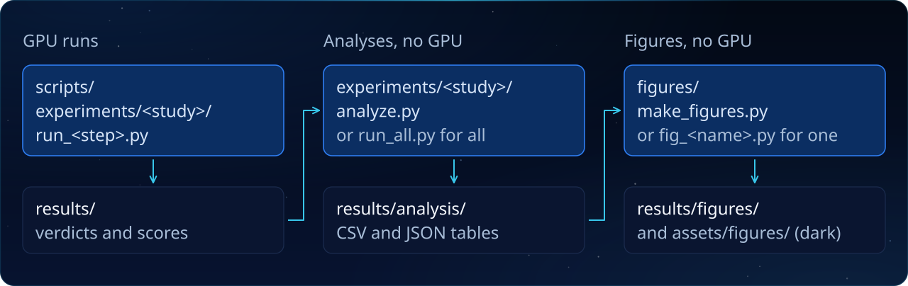
</p>
<!-- END: pipeline -->

Tables and figures, without a GPU:

```bash
python experiments/run_all.py                  # every analysis in dependency order, then the figures
python experiments/run_all.py --list           # the steps; --from <step> and --only <step> run part of it
python scripts/build_math_labels.py --check    # the shipped MATH labels cover every MATH answer in results/
```

<details>
<summary><b>The experiments</b>: what each asks and which runs it needs</summary>
<br>

| Folder | What it asks | Runs it needs |
|:--|:--|:--|
| [`main_results`](experiments/main_results/) | How accurate is each small judge alone, under adversarial personas, with majority voting and in multi-agent debate, and how well does it score open-ended answers? | the core runners in `scripts/` |
| [`large_judges`](experiments/large_judges/) | How do the large judges and the Qwen3-32B ladder judge compare under the same pipeline? | `scripts/run_judge.py`, `scripts/run_scoring_judge.py` |
| [`scaling_cost`](experiments/scaling_cost/) | What do a thousand verdicts cost to serve, and which judges sit on the cost–accuracy front? | none (reads `large_judges`) |
| [`token_budget`](experiments/token_budget/) | How does accuracy move from the quick to the reasoned budget, and which factor moves it? | `run_budget_sweep.py`, `run_single_factor.py` |
| [`adaptive_budget`](experiments/adaptive_budget/) | Can a judge choose its budget item by item without losing accuracy? | none (reads the budget sweep) |
| [`prompt_sensitivity`](experiments/prompt_sensitivity/) | Do accuracy and rankings hold when the judging instruction is reworded or rewritten? | `run_prompt_variants.py` |
| [`judging_protocols`](experiments/judging_protocols/) | What changes without the reference, with G-Eval-style scoring and with pairwise comparison? | `run_reference_free.py`, `run_geval.py`, `run_pairwise.py` |
| [`family_bias`](experiments/family_bias/) | Do judges go easier on students from their own model family? | `run_students.py`, `run_students_hf.py`, `scripts/run_judge.py` |
| [`error_analysis`](experiments/error_analysis/) | What kind of mistake does each judge make? | none (reads the verdicts) |
| [`significance`](experiments/significance/) | Which differences hold up under paired tests, equivalence tests and bootstrap intervals? | none (reads the verdicts and scores) |

</details>

Every run, step by step, and the layout of `results/` are in [docs/REPRODUCE.md](docs/REPRODUCE.md).

## Models, datasets and code

Each judge, student and reference scorer is one entry in [`models.yaml`](slmjury/configs/models.yaml). `load_dataset("<loader key>")` loads a dataset from Hugging Face.

<details>
<summary><b>Every model in the study</b>: small judges, large judges, students and reference scorers</summary>
<br>

Judges with a thinking mode use it at the reasoned budget. Judges marked *always* reason before every verdict, so they run at that budget only.

<!-- BEGIN: models -->
**Small judges** (`judge_models`)

| Family | Key | Weights | Thinks |
|:--|:--|:--|:-:|
| Llama 3.x | `llama3.2-1b` | [`meta-llama/Llama-3.2-1B-Instruct`](https://huggingface.co/meta-llama/Llama-3.2-1B-Instruct) | no |
| Llama 3.x | `llama3.2-3b` | [`meta-llama/Llama-3.2-3B-Instruct`](https://huggingface.co/meta-llama/Llama-3.2-3B-Instruct) | no |
| Llama 3.x | `llama3.1-8b` | [`meta-llama/Llama-3.1-8B-Instruct`](https://huggingface.co/meta-llama/Llama-3.1-8B-Instruct) | no |
| Qwen2.5 | `qwen2.5-1.5b` | [`Qwen/Qwen2.5-1.5B-Instruct`](https://huggingface.co/Qwen/Qwen2.5-1.5B-Instruct) | no |
| Qwen2.5 | `qwen2.5-3b` | [`Qwen/Qwen2.5-3B-Instruct`](https://huggingface.co/Qwen/Qwen2.5-3B-Instruct) | no |
| Qwen2.5 | `qwen2.5-7b` | [`Qwen/Qwen2.5-7B-Instruct`](https://huggingface.co/Qwen/Qwen2.5-7B-Instruct) | no |
| Qwen3 | `qwen3-0.6b` | [`Qwen/Qwen3-0.6B`](https://huggingface.co/Qwen/Qwen3-0.6B) | at B = 8,192 |
| Qwen3 | `qwen3-1.7b` | [`Qwen/Qwen3-1.7B`](https://huggingface.co/Qwen/Qwen3-1.7B) | at B = 8,192 |
| Qwen3 | `qwen3-4b` | [`Qwen/Qwen3-4B`](https://huggingface.co/Qwen/Qwen3-4B) | at B = 8,192 |
| Qwen3 | `qwen3-8b` | [`Qwen/Qwen3-8B`](https://huggingface.co/Qwen/Qwen3-8B) | at B = 8,192 |
| Qwen3 | `qwen3-14b` | [`Qwen/Qwen3-14B`](https://huggingface.co/Qwen/Qwen3-14B) | at B = 8,192 |
| Phi-4 | `phi4mi-3.8b` | [`microsoft/Phi-4-mini-instruct`](https://huggingface.co/microsoft/Phi-4-mini-instruct) | no |
| Phi-4 | `phi4mr-3.8b` | [`microsoft/Phi-4-mini-reasoning`](https://huggingface.co/microsoft/Phi-4-mini-reasoning) | always |
| Phi-4 | `phi4-14b` | [`microsoft/phi-4`](https://huggingface.co/microsoft/phi-4) | no |
| Phi-4 | `phi4r-14b` | [`microsoft/Phi-4-reasoning`](https://huggingface.co/microsoft/Phi-4-reasoning) | always |
| Phi-4 | `phi4rp-14b` | [`microsoft/Phi-4-reasoning-plus`](https://huggingface.co/microsoft/Phi-4-reasoning-plus) | always |

**Large judges and the ladder judge** (`large_judge_models`)

| Key | Weights | Size | Thinks |
|:--|:--|--:|:-:|
| `qwen3-32b` | [`Qwen/Qwen3-32B`](https://huggingface.co/Qwen/Qwen3-32B) | 32B | at B = 8,192 |
| `llama3.3-70b` | [`meta-llama/Llama-3.3-70B-Instruct`](https://huggingface.co/meta-llama/Llama-3.3-70B-Instruct) | 70B | no |
| `deepseek-r1-distill-llama-70b` | [`deepseek-ai/DeepSeek-R1-Distill-Llama-70B`](https://huggingface.co/deepseek-ai/DeepSeek-R1-Distill-Llama-70B) | 70B | always |
| `qwen2.5-72b` | [`Qwen/Qwen2.5-72B-Instruct`](https://huggingface.co/Qwen/Qwen2.5-72B-Instruct) | 72B | no |
| `glm-4.5-air` | [`zai-org/GLM-4.5-Air-FP8`](https://huggingface.co/zai-org/GLM-4.5-Air-FP8) | 106B (12B active) | always |
| `gpt-oss-120b` | [`openai/gpt-oss-120b`](https://huggingface.co/openai/gpt-oss-120b) | 120B | always |
| `qwen3.5-122b` | [`Qwen/Qwen3.5-122B-A10B-FP8`](https://huggingface.co/Qwen/Qwen3.5-122B-A10B-FP8) | 122B (10B active) | at B = 8,192 |

**Students** (`student_models`)

| Key | Weights | Used for |
|:--|:--|:--|
| `qwen2.5-32b` | [`Qwen/Qwen2.5-32B-Instruct-GPTQ-Int8`](https://huggingface.co/Qwen/Qwen2.5-32B-Instruct-GPTQ-Int8) | every experiment |
| `llama3.1-8b` | [`meta-llama/Llama-3.1-8B-Instruct`](https://huggingface.co/meta-llama/Llama-3.1-8B-Instruct) | every experiment |
| `deepseek-r1-0528-qwen3-8b` | [`deepseek-ai/DeepSeek-R1-0528-Qwen3-8B`](https://huggingface.co/deepseek-ai/DeepSeek-R1-0528-Qwen3-8B) | family bias |
| `mistral-7b-v0.3` | [`mistralai/Mistral-7B-Instruct-v0.3`](https://huggingface.co/mistralai/Mistral-7B-Instruct-v0.3) | family bias |
| `qwen3-14b-student` | [`Qwen/Qwen3-14B`](https://huggingface.co/Qwen/Qwen3-14B) | family bias |
| `gemma4-31b-student` | [`google/gemma-4-31B-it`](https://huggingface.co/google/gemma-4-31B-it) | family bias |
| `glm-4.7-flash` | [`zai-org/GLM-4.7-Flash`](https://huggingface.co/zai-org/GLM-4.7-Flash) | family bias |
| `qwen3.5-35b-student` | [`Qwen/Qwen3.5-35B-A3B`](https://huggingface.co/Qwen/Qwen3.5-35B-A3B) | family bias |

**MT-Bench reference scorers** (`reference_models`, served through the Together API)

| Key | Model |
|:--|:--|
| `gpt-oss-120b` | [`openai/gpt-oss-120b`](https://huggingface.co/openai/gpt-oss-120b) |
| `qwen3.5-397b` | [`Qwen/Qwen3.5-397B-A17B`](https://huggingface.co/Qwen/Qwen3.5-397B-A17B) |
<!-- END: models -->

</details>

<details>
<summary><b>Datasets</b>: closed-ended and open-ended</summary>
<br>

<!-- BEGIN: datasets -->
| Dataset | Loader key | Domain | Answer | Items per student |
|:--|:--|:--|:--|--:|
| GSM8K | `gsm8k` | math | number | 1,319 |
| GSM-Plus | `gsm_plus` | math | number | 10,552 |
| MATH | `math` | math | LaTeX expression | 5,000 |
| ARC-Easy | `arc_easy` | science | multiple choice | 2,376 |
| ARC-Challenge | `arc_challenge` | science | multiple choice | 1,172 |
| HellaSwag | `hellaswag` | general | multiple choice | 10,042 |
| WinoGrande | `winogrande` | general | multiple choice | 1,267 |
| TruthfulQA | `truthfulqa` | general | multiple choice | 684 |

<sub>Eight closed-ended datasets, each judged on the solutions of both students: 64,824 judgments per configuration.</sub>

| Dataset | Loader key | Task | Items | Reference scores |
|:--|:--|:--|--:|:--|
| SummEval | `summeval` | rate a summary on coherence, consistency, fluency and relevance (1–5) | 1,600 summaries of 100 articles | human annotations |
| MT-Bench | `mtbench` | rate a two-turn conversation (1–5) | 80 questions × both students | Qwen3.5-397B-A17B, with GPT-OSS-120B as a second scorer |
<!-- END: datasets -->

</details>

<details>
<summary><b>Project structure</b></summary>
<br>

```
SLMJury/
├── slmjury/               the pip package
│   ├── configs/           models.yaml (judges, students, reference scorers) and prompt_variants.yaml
│   ├── data/              dataset loaders
│   ├── parsers/           answer extraction, verdict and score parsing, MATH equivalence labels
│   ├── core/              student solver, judge, evaluator and open-ended scoring
│   ├── strategies/        adversarial personas, majority voting and multi-agent debate
│   └── analysis/          accuracy counting, paired statistics, open-ended metrics, results paths
├── scripts/               command-line runners for the core pipeline, and the MATH label builder
├── experiments/           one folder per study (run_*.py runners, analyze*.py analyses) and run_all.py
├── figures/               the figure scripts and make_figures.py
├── tests/                 unit tests (pytest)
├── docs/                  REPRODUCE.md: every experiment, step by step
├── assets/                banner, the paper's figures and this page's images (dark theme)
└── website/               the project site (React, Vite)
```

</details>

## Citation

<!-- BEGIN: citation -->
If you use SLMJury, please cite our EACL 2027 paper ([arXiv:2606.07810](https://arxiv.org/abs/2606.07810)):

```bibtex
@inproceedings{laddha2026slmjurysmalllanguagemodels,
      title={SLMJury: Can Small Language Models Judge as Well as Large Ones?},
      author={Anish Laddha and Nitesh Pradhan and Gaurav Srivastava},
      booktitle={Proceedings of the 2027 Conference of the European Chapter of the Association for Computational Linguistics (EACL 2027)},
      year={2027},
      eprint={2606.07810},
      archivePrefix={arXiv},
      primaryClass={cs.CL},
      url={https://arxiv.org/abs/2606.07810},
}
```
<!-- END: citation -->

## Contributing, contact and license

Issues and pull requests are welcome. A new judge is one entry in `models.yaml`. Please run the tests first:

```bash
pip install -e ".[dev]"
python -m pytest tests
```

- **Email**: [anshladdha15@gmail.com](mailto:anshladdha15@gmail.com), [nitesh.pradhan@lnmiit.ac.in](mailto:nitesh.pradhan@lnmiit.ac.in), [gks@vt.edu](mailto:gks@vt.edu)
- **Issues**: [GitHub Issues](https://github.com/anishh15/SLMJury/issues)
- **License**: Apache 2.0 ([LICENSE](LICENSE))

---

<div align="center">

**By [Anish Laddha](https://github.com/anishh15) and Nitesh Pradhan (LNMIIT, India), and [Gaurav Srivastava](https://github.com/ctrl-gaurav) (Virginia Tech, USA)**

</div>
